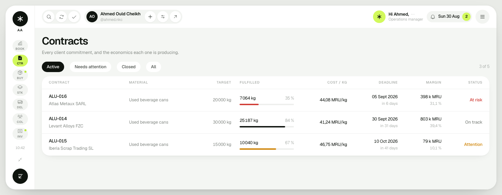
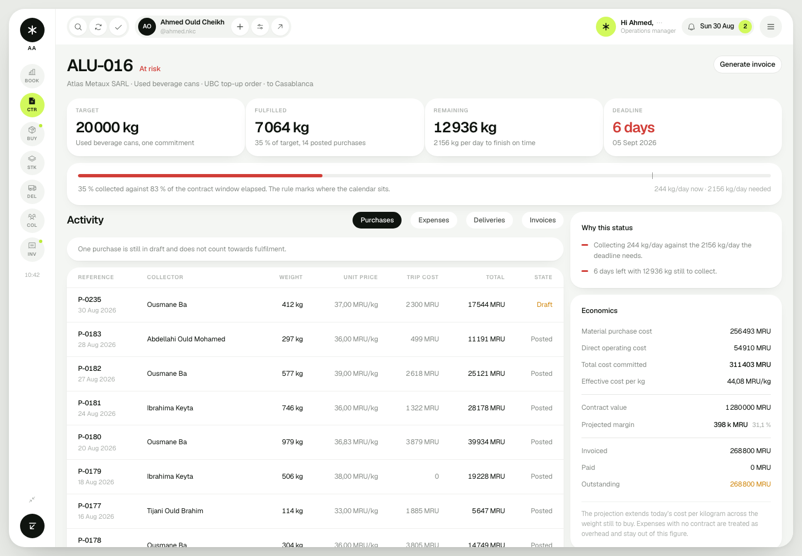
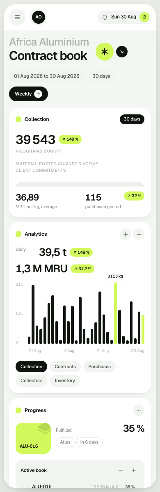

# 01 — Frontend foundation, dashboard and contract workspace

**Date:** 30 August 2026
**Slice:** web application shell, canonical calculation layer, Overview,
Contracts list, Contract workspace
**Gates covered:** part of gate 3 (management visibility) in
[wiki/25](wiki/25-build-order-and-review-gates.md), built on a frontend-side
implementation of the gate 2 calculations
**Status:** superseded by [02](02-nextjs-rebuild.md). The React application this describes was deleted and rebuilt on Next.js. Kept as history; its screenshots no longer exist.

---

## 1. What this slice answers

A manager can open the product and answer, without asking anyone:

- How is the operation doing today, and which contract needs a decision first.
- For any contract: how much was promised, how much is collected, how much
  remains, what it actually cost per kilogram, and whether it is still profitable.
- Why a contract is flagged, in a sentence they can act on.
- Where every headline number came from.

## 2. Design direction

The client supplied two dashboard screenshots (`references/`) and asked for that
design, carrying this product's content. The first pass borrowed the reference's
structure but substituted a graphite and green palette. That was a misread of the
brief and was rebuilt; the record of the corrected direction is
[decisions/0006](decisions/0006-ui-matched-to-client-reference.md).

The implemented system:

- **Three stacked layers.** The icon rail sits on the lavender canvas, the
  near-black navigation panel floats above it, and the white content sheet sits
  on top of the panel, lapping over its right edge with a shadow falling onto
  it. That stack is what gives the reference its depth, and it is why the panel
  is not simply a third column.
- **Lavender canvas, white sheets, one violet accent.**
- **Status colour is reserved.** Green, amber and rose appear only on contract
  health, so a colour on screen always means a state.
- **Locked radii**: floating panels 22px, cards 18px, controls 12px, pills full.
- **Plus Jakarta Sans**, matching the reference, with tabular figures on every
  number so money and weight columns still align.
- **One violet button per screen**, in the top bar. Page actions are white.

Each element of the reference maps onto something the business already tracks
rather than onto an invented feature:

| Reference | Here |
|---|---|
| Storage meter | Monthly container goal against collected weight |
| Recently edited files | Contracts in flight, previews showing real fulfilment |
| Shared folders | Stock by material, first card filled to anchor the row |
| Tabs over the file table | Purchase ledger: posted, drafts, voided |
| File table with checkboxes | Purchase ledger with bulk selection |
| Selected-row action bar | Export, print, attach, open, void |

Three deliberate departures, each with a reason: avatars are initials rather than
stock portraits, because these stand for real collectors and inventing faces for
them would be worse than an honest monogram; a collection trend chart was kept
even though the reference has none, because wiki/13 requires the dashboard to
answer how collection is trending; and the panel's foot card is a live carousel
of contracts needing a decision rather than an illustration.

Two honest notes on method. Pinterest was not browsable for reference gathering;
it blocks automated access without a login. And the anti-slop frontend skill
scopes itself out of dashboards and data tables, so its taste layer was applied
(anti-pattern list, contrast, full state cycles) while its landing-page layout
rules were not.

## 3. What was built

### Overview

Contracts in flight as preview cards ordered by which needs a decision first,
stock by material as folder cards, the collection trend with the period's
headline figures, and the purchase ledger as a tabbed table with row selection
and a floating bulk-action bar. The monthly container goal sits in the top strip.


The same screen in dark theme. The navigation shell keeps its colour; the sheets
and cards invert around it.


### Contracts

Filtered by active, needs attention, closed or all, searchable, with fulfilment,
deadline pressure, margin and health on every row.



### Contract workspace

The differentiating screen from [idea.md](idea.md) section 9. Three things here
are worth more than the rest of the slice:

1. **The fulfilment bar carries a time marker.** The fill is collection; the
   marker is where the calendar sits inside the contract window. "35 % collected
   against 83 % of the contract window elapsed" is the whole risk question in one
   glance.
2. **"Why this status" prints the reasons.** Health is derived, never a field
   someone maintains, and the derivation is shown in language a manager can act
   on rather than a coloured dot they have to interpret.
3. **Economics runs from material cost to outstanding cash** in one column:
   material, direct operating, total committed, cost per kilogram, contract
   value, projected margin, invoiced, paid, outstanding.



### Responsive behaviour

The rail and panel collapse into a drawer below 1024px, table columns drop by
priority, and the layout holds at 390px.



## 4. Architecture, and the one rule that matters

```text
domain/types.ts      facts only, mirroring wiki/24
      ↓
lib/calc.ts          CANONICAL calculations, implementing wiki/07
      ↓
domain/selectors.ts  read models
      ↓
pages/               screens
```

**No component performs arithmetic.** Every derived number on every screen comes
from `lib/calc.ts` through a selector. This is what stops the dashboard, the
contract workspace and a future invoice from disagreeing about margin, and it is
the frontend half of the canonicalisation rule in `claude.md`.

Supporting decisions:

- **Facts in, derivations out.** Types carry only what a user entered.
  Fulfilment, remaining, cost per kilogram, margin and health are computed, so a
  correction recomputes the whole chain.
- **Rounding happens once**, in `lib/format.ts`, at the display boundary. No
  intermediate value is ever rounded ([wiki/07](wiki/07-calculations.md) §11).
- **Guarded denominators return `null`, not zero.** A contract with no purchases
  shows "no quantity yet" rather than a misleading `0,00 MRU/kg`.
- **Money carries its currency** and is formatted in the French convention the
  source ledger uses, since the operating language is unresolved.
- **Every headline number links to its records.** A KPI a manager cannot open is
  a KPI they cannot trust ([wiki/13](wiki/13-dashboard-analytics.md)).

Full rationale in
[decisions/0005](decisions/0005-frontend-stack-and-ui-system.md).

### Provisional rules, marked as such in code

Two things the code needs but the business has not yet confirmed. Both sit in one
place with a comment naming the open question, so the client conversation turns
into a settings change rather than a code hunt.

| Rule | Where | Open question |
|---|---|---|
| Health thresholds (pace, deadline proximity, margin floors) | `HEALTH_THRESHOLDS` in `lib/calc.ts` | thresholds need client validation, [idea.md](idea.md) §10 |
| Cost allocation: trip costs on posted purchases plus contract-tagged expenses; untagged expenses stay as overhead | `contractMetrics` in `lib/calc.ts` | [wiki/22](wiki/22-open-questions.md) #11-15 |

## 5. Demo data

Deterministic and seeded, shaped from the real ledger analysed in
[wiki/02](wiki/02-source-analysis-excel.md): French supplier names, UBC bought
at roughly 30-42 MRU/kg, trip costs captured on the purchase row, July and
August operating cycles. It deliberately contains a voided purchase, drafts
waiting on a second weighing, an over-fulfilled closed contract and one contract
in each of the three health states, so every state in the UI is reachable
without editing data.

It is demo data, not a business rule. `domain/selectors.ts` is the seam where it
gets replaced by API calls.

## 6. Verification

Typecheck, lint and production build are clean. Every screen was rendered in
headless Chrome and reviewed as an image, in both themes, at desktop, 828px and a
true 390px phone viewport (`scrollWidth == clientWidth`, no horizontal overflow).

Rendering rather than trusting the markup found four real defects, all fixed:

| Found | Fix |
|---|---|
| Table headers and dates wrapped in narrow columns | non-wrapping numeric cells, shorter header labels, re-tuned widths |
| Left column dead-ended under the chart while the right column ran long | activity feed moved into the left column |
| "Record purchase" appeared twice on the contract workspace, competing with itself | the global quick action was demoted to a secondary style; each page keeps one primary |
| Contract activity tables rendered every row | tables show ten rows and open the rest on request |
| Folder cards rendered as a detached tab beside a lavender block instead of one folder silhouette | tab and body share a fill and merge; the back sheet tucks behind |
| The stock grid left an empty fourth cell | grid sized to the number of cards |
| White panels vanished against the white sheet | tables sit directly on the sheet, grouped blocks use the soft grey card |
| The shell read as three flat columns rather than the reference's stacked layers | the sheet now laps over the panel with a directional shadow; the panel floats above the canvas |
| The whole interface sat about 15 % smaller than the reference | rail tiles, panel width, nav rows and type scaled up to match |
| The panel search was a filled field; the reference uses a row with a rule | rebuilt as a bordered row |

One apparent mobile overflow was **not** a bug: Chrome clamps its window to
about 500 CSS pixels, so a `--window-size=414` screenshot renders at 500 and
crops the image. Confirmed by measuring the document inside the page rather than
by looking at the picture.

## 7. Deliberately not finished

- Screens beyond Overview, Contracts and the contract workspace render an honest
  "not built yet" panel naming their gate in
  [wiki/25](wiki/25-build-order-and-review-gates.md). Nothing fakes content.
- The application is read-only. There is no store and no mutation yet.
- No backend. `lib/calc.ts` must be ported to the server when it exists; if the
  two ever diverge, the product loses its single definition of margin.
- UI copy is English while numbers use the French convention
  ([wiki/22](wiki/22-open-questions.md) #27 is unresolved).

## 8. Next slice

Gate 2, procurement core: the purchases ledger and the fast entry form behind
"Record purchase". That is the slice where the application stops being read-only,
so it brings a store, validation, optimistic entry and the correction trail with
it. Inventory, collectors and expenses follow.
