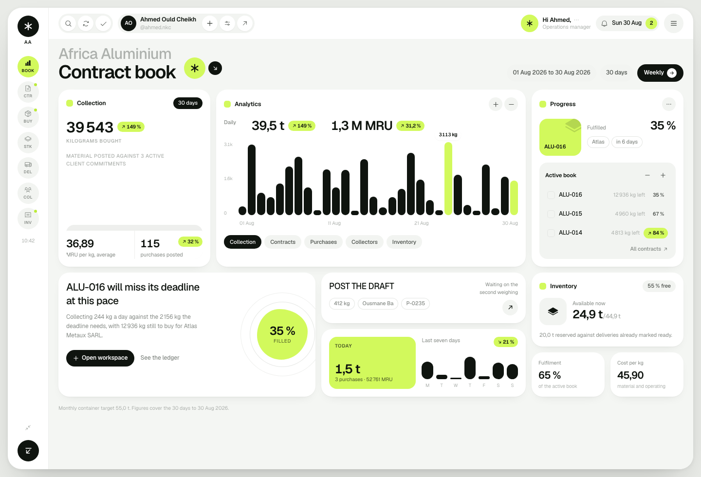

# 02 — Next.js rebuild: the instrument language

**Date:** 30 August 2026
**Slice:** the frontend, rebuilt from zero on Next.js with a new visual language
**Supersedes:** [01](01-frontend-foundation.md), whose interface no longer exists
**Status:** architecture current; the visual language is superseded by [03](03-bento-dashboard.md), and the screenshots below no longer match what ships.

---

## 1. Why there was a rebuild

Two interfaces were rejected. The verdict on the second was that colour,
typography, layout and finish all fell short, so this was not a re-skin: the
React application was deleted and the interface rebuilt from nothing.

One thing was carried across deliberately. `lib/calc.ts`, `lib/format.ts` and
`domain/*` are the canonical business logic, not UI. Deleting them because a
visual direction failed would have thrown away the correctness work with the
paint. They moved into the new app unchanged and still typecheck.

## 2. How the direction was set

Rather than guessing a third time, the direction came from a structured
interview: visual lane, what specifically failed, a physical scene to decide
light against dark, and density. The answers were **Linear and Raycast
precision**, everything failed, **an office desk in daylight**, and **dense, for
daily operators**.

The client then asked that the repository's own UI guidance be set aside, so
`docs/wiki/16` no longer governs the interface. The strategic context that does
govern it now lives in [PRODUCT.md](PRODUCT.md), and the visual system in
[DESIGN.md](DESIGN.md).

## 3. The language

Warm paper, cold ink, hairlines. Light, near-monochrome, dense. Structure comes
from rules and alignment, never boxes and shadows. There are no cards in the
application.

Three decisions carry most of the weight:

**Green is not the accent.** "Recycling company" makes every model reach for
green, and that reflex is a large part of why the earlier attempts read as
generic. The accent is an archival blue, held under 10 % of the surface and used
only for selection, focus and progress.

**Healthy carries no colour.** On track is uncoloured; amber and red are earned
by exception. If everything were tinted, nothing would stand out. Status always
ships with a word, so colour is never the only carrier.

**The dashboard is a book, not a tile wall.** The hero-metric row of KPI cards
is the category cliché, and it is gone. The period figures are set as a
statement divided by hairlines, and the contract table itself is the dashboard.



## 4. What was built

| Screen | State |
|---|---|
| Contract book (`/`) | Period statement, daily collection band, active contract table, latest purchases, today rail |
| Contracts (`/contracts`) | Filtered by active, needs attention, closed, all |
| Contract workspace (`/contracts/[id]`) | Terms statement, fulfilment against the calendar, derived health reasons, economics, four activity tabs |
| Purchases (`/purchases`) | Full ledger, posted, drafts and voided |
| Inventory (`/inventory`) | Position by material and location, on hand, reserved, available |
| Collectors (`/collectors`) | Volume, spend, average price, recency |
| Invoices (`/invoices`) | Invoiced, paid, outstanding |
| Eight further routes | Honest "not built yet" panels naming what they wait on |


The workspace keeps the one device worth keeping from earlier work: the
fulfilment bar carries a rule marking where the calendar sits inside the
contract window, so "35 % collected against 83 % of the window elapsed" is
visible at a glance. Health is derived and its reasons are printed in plain
language rather than reduced to a coloured dot.

## 5. Architecture

```
domain/types.ts      facts only
      ↓
lib/calc.ts          canonical calculations
      ↓
domain/selectors.ts  read models
      ↓
app/(app)/*          server components
```

Pages are **server components** reading the domain layer directly, so the
dataset never reaches the client bundle. The only client islands are the command
palette and the mobile navigation sheet. Filters and tabs are URL search params,
which makes every view shareable and server-rendered rather than trapped in
component state.

No component performs arithmetic. Every derived number comes from `lib/calc.ts`
through a selector, which is what stops two screens from disagreeing about
margin.

## 6. Verification

Typecheck, ESLint and the production build are clean. Every screen was rendered
and reviewed as an image at 1440 px and at a true 390 px phone viewport.

Defects found by looking, and fixed:

| Found | Fix |
|---|---|
| Em dashes used as "no value" placeholders, which the design rules ban | a mono `0`, which is unambiguous and aligns in the column |
| Margin amount and its percentage collided in one string | percentage split into a muted trailing span |
| Only the contract number was clickable in a row of a navigable table | the link stretches over the whole row |
| The contract table clipped its last column on a phone | columns drop by priority, and health moves into the contract cell |
| The chart header cramped into two columns at phone width | stacks below `sm` |
| `setState` inside an effect, and a mutable accumulator during render | the drawer closes through the navigation callback; grouping is derived from the previous row |

## 7. Deliberately not finished

- The application is read-only. There is no store, no mutation, no server action
  yet. The purchase form is the next slice and the point where that changes.
- Light theme only. A dark theme would be a token swap, but the scene that chose
  light did not ask for one.
- Eight routes render an honest placeholder naming what they wait on.
- No backend. `lib/calc.ts` must be ported to the server when one exists; if the
  two diverge, the product loses its single definition of margin.

## 8. Next

The fast purchase entry form: collector, material, weight, unit price, posted in
seconds. It brings a store, validation, optimistic entry and the correction
trail, and it is the slice where the application stops being read-only.
