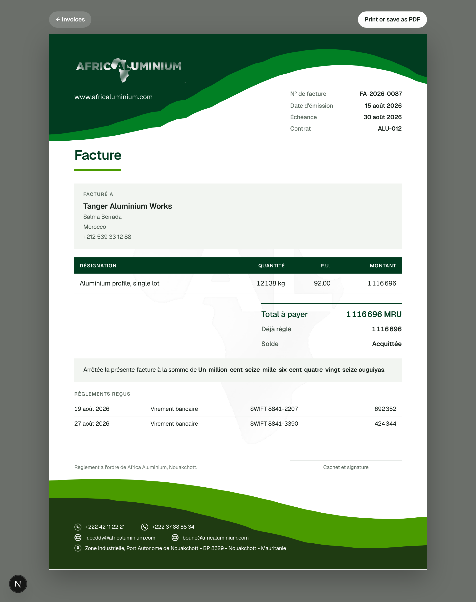
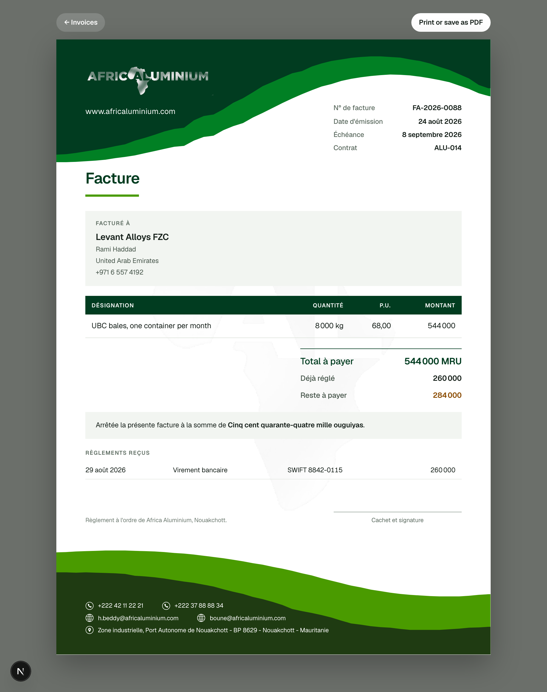

# 14 — The invoice document

Date: 31 August 2026
Slice: the invoice as the client receives it, on the company's own letterhead.

## 1. What was missing

Report 13 left the invoice existing as data — frozen at issue, with a line that
multiplies out — but with no way to put it in front of a client. This is the
last piece of the flow the client described: record the day, watch the goal,
export the month, **invoice**.

## 2. Two decisions

### The document is a page, not a generated file

`docs/wiki/12` asks for stable printable PDFs and, in the same sentence, that
the PDF must not become a separately maintained source. Server-side rendering —
headless Chrome, or a PDF library — satisfies the first and violates the second:
it means laying the invoice out twice, once for the file and once for whatever
preview the manager wants before sending.

So the invoice is a real route with a print stylesheet. Sizes in millimetres,
`@page { size: A4; margin: 0 }`, and the letterhead `position: fixed` so the
browser repeats the stationery on every sheet if an invoice runs long. One
layout: what is on screen is what comes out of the printer. Written up as
[decision 0015](decisions/0015-the-document-is-the-page.md), which also notes
that a downloadable file, if wanted later, is headless Chrome printing this same
route — a deployment decision, not a rewrite.

### The letterhead is traced, not photographed

`receipt.png` is a blank letterhead: two green waves, the wordmark, a large
continent watermark. The lazy version uses it as a background image and
absolutely positions text over it.

Instead the wave boundaries were traced out of the file column by column,
median-filtered where the website line and the footer icons crossed the trace,
and emitted as SVG paths normalised to a 0-100 box. The four colours were
sampled from the same file: `#013c20` and `#018024` in the header, `#4a9b00`
and `#1f3b12` in the footer. The wordmark and the continent mark were cut from
it with their backgrounds keyed out — neutral grey plus a luminance alpha, so
no green fringe survives — and saved to `public/`.

The artwork is theirs rather than a lookalike, and it is vector where it can be,
so it prints crisp instead of as a 1414px photograph of their stationery.

## 3. What was built

`src/lib/amount-in-words.ts` — the total in French words, for the line every
invoice in the region carries: *Arrêtée la présente facture à la somme de …*.
The traditional spelling, not the 1990 reform's hyphenate-everything rule, which
turns a seven-figure total into one fifty-character word.

`src/server/documents/invoice.ts` — the document as typed data, assembled once
and handed to whatever draws it. The totals are read back from what was written
at issue; only the payment position is read fresh, because that is the part
meant to move.

`src/components/document/Letterhead.tsx` and `src/app/document.css` — the
stationery and the print rules.

`/invoices/[invoiceId]` — the page, in a `(document)` route group with no
application shell, so what prints is the sheet and nothing else. In French:
number, dates, contract, the client block, the lines, the total, the amount in
letters, the payments received, what is still owed, and a signature rule.

Six nullable columns on `organizations` — `postal_box`, `country`, `phones`,
`emails`, `tax_identifier`, `registration_line` — additive, no data touched.
The verified letterhead details had been sitting in a TypeScript constant and
never reaching the database; now correcting them is a settings change.

## 4. What is deliberately absent

No tax identifier, no registration line, no VAT. None appears on the supplied
letterhead, and `docs/wiki/22` #22, #23 and #30 remain unanswered: whether this
is a tax document, what registration line Mauritania requires, whether a stamp
is needed.

The two columns exist and are null. The document prints them when they are
filled and prints nothing when they are not, and a test asserts it invents
neither. The stamp question is answered cheaply in the meantime: a signature
rule labelled *Cachet et signature*, which is correct either way.

## 5. Fitting one page

The first render ran to 326.9mm against A4's 297mm — it would have printed on
two sheets — and the title sat behind the header wave, which runs 59mm deep on
the left and only 17mm on the right.

Both were fixed by measuring rather than guessing: a script read every block's
top, bottom and height in millimetres out of the live page. The head now steps
down from right to left with the wave's diagonal — the invoice meta high on the
right where the band is shallow, the title below it on the left where it is
deep — and 34mm was trimmed across the blocks. The sheet now measures exactly
297.0mm, with the closing line clearing the footer wave.

## 6. What was verified

**323 tests**, 12 files, all passing. 57 are new:

- `tests/amount-in-words.test.ts` (44) — every place French spelling changes:
  the seventies and eighties counting on from soixante and quatre-vingt, "et"
  replacing the hyphen, the plural of cent and vingt appearing before *millions*
  and disappearing before *mille*, and mille never inflecting. This caught a
  real bug: the first version wrote *deux-cents-mille* where French requires
  *deux cent mille*.
- `tests/document.test.ts` (13) — the document prints the total frozen at issue
  even after the line beneath it is rewritten; never prints "1 kg" for a lump
  sum; carries the company's own contacts; invents no registration number;
  lists payments oldest first; and does not exist for another organisation.

**20 browser checks** in `scripts/e2e-document.mjs`, all passing: the document
measures 297mm, is in French, shows the weight and price, states the amount in
letters, carries their phones and postal box, draws its four waves, drops the
toolbar when printing, fixes the letterhead so it repeats, asks for A4 with no
browser margin, and — after a part payment — shows what was received, what is
still owed, the payment with its reference and method, and a total that did not
move when the money arrived.

Three of those checks failed on the first run and all three were the test's
fault: `innerText` returns the CSS-uppercased *FACTURÉ À*, Chrome serialises the
page size as lowercase `a4`, and the payment step had never selected bank
transfer so the document correctly printed *Espèces*. The page was right in
every case.

`npm run build` succeeds, ESLint is clean, and the migration is six additive
nullable columns.

## 7. How it looks

## 8. Next

Importing the real July and August workbook rows, so the manager opens the app
to his own book rather than to a demo shaped like it.
