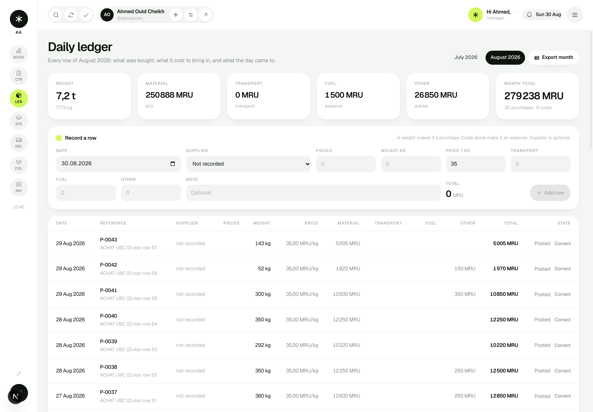

# 15 — Importing the real workbook

Date: 31 August 2026
Slice: the manager's own July and August, in the application, with a report of
everything wrong with the source.

## 1. Reading the sheet before writing the importer

`ACHAT UBC (2).xlsx` is one worksheet holding two month blocks stacked
vertically, 52 data rows, a client tranche block off to the right in columns O
to W, and the line `GOAL 1 CONTENAIR PER MONTH`.

Before writing anything that could touch it, I checked the sheet against its own
arithmetic. Four faults came out, and they shaped the whole slice:

| Fault | Where | Effect |
|---|---|---|
| A weight stored as text (`'90.7'`) | row 27 | Excel's `SUM` skips text, so **the sheet's own August weight total is 90,7 kg short**: it states 7 081,8 where the rows come to 7 172,5 |
| PRIX ≠ POIDS × P.U | rows 27, 30 | 4,5 short and 247,5 over. Together, the 243 MRU by which the application's August total differs from the workbook's |
| A date typed as `28082026` | rows 53, 54 | an integer in a General cell, not a date |
| No supplier at all | 34 of 52 rows | the column has always been optional here (decision 0009) |

July is clean: every column reconciles exactly.

## 2. The decision

Import the rows as they stand. Report the faults. Correct nothing.

[Decision 0016](decisions/0016-import-reports-never-corrects.md) sets it out
and names the price it carries: **the application shows August as 279 238 MRU
where the workbook says 279 480,5.** That 243 MRU is entirely rows 27 and 30.
The application derives the total from the weight and the price, the two facts
the manager wrote; the workbook's MONTANT used a third number agreeing with
neither.

The two alternatives are both worse. Deriving a unit price from PRIX ÷ POIDS
invents a rate nobody agreed to. Overriding the computed total with MONTANT
makes those rows' arithmetic unlike every other row's, and buries the
discrepancy for good. As it stands the manager has two row numbers and can amend
either in seconds, because corrections already exist (decision 0013).

`MOUSSA`/`MOUSSA 2` and `TEREIRA`/`TERREIRA` are almost certainly one person
each. They are imported as separate collectors and **reported as possible
duplicates**. Merging two suppliers changes who the company bought from; that is
not a decision an importer gets to make.

## 3. What was built

`src/server/import/workbook.ts` — a parser, not an importer. It turns the grid
into typed rows and a list of everything that looks wrong, and changes nothing.
Dates arrive three ways (a real date, an Excel serial, or eight typed digits)
and all three are handled.

`src/server/import/read-xlsx.ts` — the file-to-grid step, kept separate so the
parsing rules can be tested against literal cell values with no file involved.

`src/server/import/apply.ts` — writes through the same `recordEntry` the daily
ledger uses, so an imported purchase moves stock and writes an audit entry
exactly like one typed today. There is no second write path to drift.

`scripts/import-workbook.mts` — `npm run import:workbook` prints the report and
writes nothing; `-- --apply` writes. Every row carries `import:<file>:<row>` as
its idempotency key, so a second run reports all 52 as already present and
writes nothing. The dry run asks the same question, so it predicts the real run
rather than guessing.

`npm run db:real` — seeds the reference data only (organisation, people,
materials, locations) and imports the workbook on top, so the manager opens the
application to his own book. `npm run db:seed` still gives the demo.

## 4. Two things the real data exposed

**An unlabelled zero.** The dashboard showed two bare figures side by side. The
second was projected margin, which is zero when there are no contracts, and the
company has none recorded. Both figures are now labelled, and with no active
book the second shows what he actually **spent** instead of a projection of
nothing.

**An invented target.** The dashboard footnote read "Monthly container target
55,0 t". That number is a demo constant; the real goal is one container, and
nobody has said what a container weighs (`docs/wiki/22` #31). A real load now
leaves the target null, the dashboard says "one container, not yet weighed in
kilograms", and the Excel export says `1 conteneur (non pesé)` rather than
`0 kg`.

Both were only visible because the fiction was replaced with fact.

## 5. What is not imported

The **tranche block** — eight tranches against `AHMEDOU`, 8 988 MRU outstanding
— carries no dates, and an invoice needs an issue date. Inventing one would put
a fabricated date on a document that gets printed and handed to a client. It
stays in the report until the company supplies dates and answers whether
AHMEDOU is a client or a financier (#32).

## 6. What was verified

**357 tests**, 14 files, all passing. 33 are new:

- `tests/workbook.test.ts` (22) — run against the real file, asserting the
  specific faults above, plus the parsing rules on literal cells.
- `tests/import.test.ts` (11) — a dry run writes nothing; July reconciles on
  both figures; August's money reconciles and its weight is reported as not
  matching; the source row is recorded against everything created; stock moves
  by exactly the imported weight (10 447,5 kg); and **running it again imports
  nothing and leaves stock untouched**.

Two bugs were caught by the tests as I wrote them. Column A is a merged cell, so
ExcelJS repeats the month label on every row, which made the `TOTAL` rows parse
as data. And the dry run reported rows as importable that were already in the
book, because it never asked.

**69 browser checks across six suites**, all passing against the real data.

## 7. The harness had to be fixed too

Three suites started crashing once the pages carried 43 real rows: a server
action plus `revalidatePath` tears the execution context down, and an expression
evaluated in that window returns no result at all. Fixed sleeps had hidden it
while the pages were small.

The six scripts each carried their own copy of the browser plumbing, including
six copies of the sign-in form-filling. They now share `scripts/cdp.mjs`, whose
`evaluate` retries when the context goes away and throws on a genuine page
exception. That is the fix; a longer sleep is not.

Surfacing exceptions rather than swallowing them immediately paid: two suites
started failing loudly on a sign-in that had been silently returning nothing.

It also exposed something worse. Every script reused a fixed Chrome profile
directory, and Chrome keeps cookies there. A run inherited the **signed-in
session of the run before it**, so `/contracts` no longer redirected and every
check about the guard had quietly stopped testing anything. It only showed up
because the same suite passed once and then failed on a second run. Each run now
gets a profile directory of its own, named with the process id, and removes it
on the way out.

The auth suite also turned out to be **stale**. It signed in as a driver to
check the role refusal screen, but report 08 narrowed the scope so only the
manager and the owner carry a password. The test had been asserting behaviour
the product deliberately gave up. Its three role checks are now: a driver has no
password and cannot sign in, nor can the accountant, and an unknown address is
refused in exactly the same words as a known one. The permission matrix itself
stays covered exhaustively by `tests/permissions.test.ts`.

## 8. How it looks

His own August, each row citing the workbook row it came from:

## 9. Next

The tranche block, once the client supplies dates — it is the last piece of the
workbook not yet in the system. Failing that, the stub routes: deliveries,
expenses, payments and profitability.
