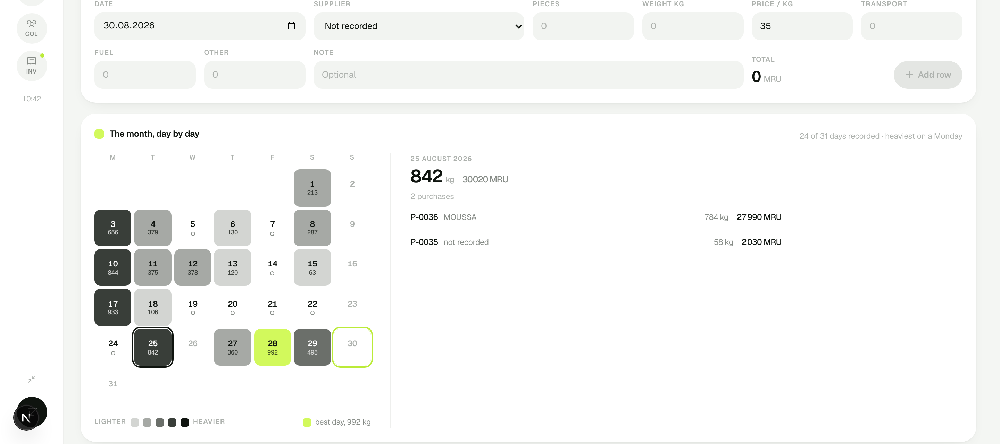
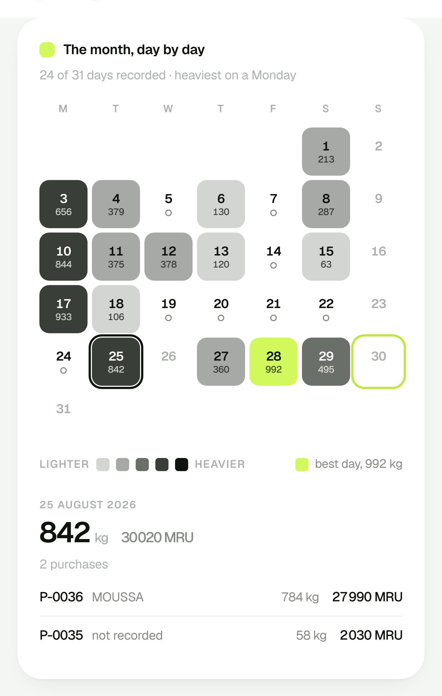

# 17 — The month, day by day

Date: 31 August 2026
Slice: a calendar on the daily ledger; which days were recorded, how much came
in, and the rows behind any one of them.

## 1. The design decision that mattered

A heat-mapped calendar has one obvious execution: green squares, darker for
more, the GitHub contribution graph. It is the first thing anyone reaches for
and it is wrong here twice over.

`DESIGN.md` reserves lime for **good, and only good**: the active rail tile, a
positive delta, the peak bar, the operating day. Spending it on a quantity would
make a heavy day and a healthy contract the same colour. And `PRODUCT.md` lists
eco-green as an **anti-reference**: "no green gradients, no leaf motifs. This is
heavy industry and money, not a campaign."

So weight rides on **darkness of ink**, five steps from a whisper of grey to
full near-black, and lime is spent on exactly two tiles: the best day of the
month, and today. That is the same way the dashboard already spends it on its
peak bar, so the two screens agree about what colour means.

The consequence is a month that reads as a shape before a single number is
read, in a palette that says nothing about recycling and everything about a
ledger.

## 2. What a tile says

| Mark | Meaning |
|---|---|
| Filled, darker with weight | material came in; the kilograms are printed under the day |
| Lime fill | the best day of the month |
| Lime ring | today |
| Ink ring | the day being looked at |
| Small hollow ring | the day cost money and brought nothing back |
| Nothing | nothing was recorded |

Absence of a mark is the resting state, per the design principles. Every one of
those marks is named in the legend and in the tile's accessible name, because
`PRODUCT.md` requires that status never travel by colour alone.

## 3. Not a modal

Choosing a day sets `?day=2026-08-25` and the panel beside the calendar renders
from it on the server. No client JavaScript, no dialog, no focus trap: the back
button works, the state is linkable, and every tile is a real link that keyboard
and screen reader reach in order. It follows `?month=`, `?edit=` and `?pay=`,
which the application already uses.

The panel shows the day's own rows, which is the question a day actually raises.

## 4. What the first pass got wrong

The tiles came out 160 px: a page of grey blocks rather than an instrument,
against the "density serves the operator" principle. The month column is now
fixed at 398 px, which puts the tiles near 52 px and gives the panel the rest.

The panel showed aggregate statistics when the request was to see what was
taken that day. It now lists the rows.

Today and the selected day both drew an ink ring and were indistinguishable.
Today took the lime ring, which `DESIGN.md` already sanctions for the operating
day.

## 5. What was verified

**388 tests**, 17 of them new in `tests/calendar.test.ts`: every week is whole
and starts on a Monday, padding is never counted as a recorded day, a
costs-only day carries rows but no darkness, intensity is a true share of the
busiest day, exactly one best day is marked and none when nothing was
collected, and the five steps rise without gaps.

In the browser at 1440 and 414: the grid composes rather than shrinks, 24
tiles are links and the 7 empty days are inert, the selected day carries
`aria-current`, today is named in its accessible name, and every tile is
keyboard reachable. Sample name: `25: 842 kg in 2 rows, 30 020 MRU`.

Lint clean, build compiles.

## 6. How it looks

## 7. Not done

An empty day is inert. Clicking one could pre-fill the entry form with that
date, which is the obvious next move and was left out of this slice
deliberately.
